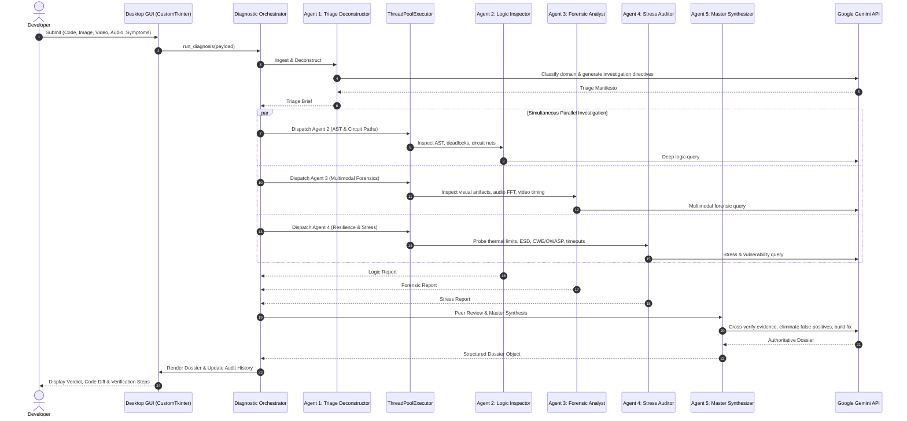

# 🏛️ Dev Diagnosis • Architectural Blueprint & Engineering Design

This document details the internal design, agent orchestration mechanics, concurrency model, and multimodal processing pipeline of **Dev Diagnosis**.

---

## 1. System Architecture Overview

Dev Diagnosis decomposes complex developer diagnostic problems across **5 specialized autonomous agents**. Rather than attempting to solve high-entropy debugging in a single monolithic prompt, the system employs an **Ingest-Branch-Synthesize** workflow.



---

## 2. Agent Specialization Matrix

| Agent | Responsibility | Key Analytical Tools & Heuristics |
| :--- | :--- | :--- |
| **Agent 1: Triage Deconstructor** | • Classifies defect domain (Software, Hardware, Embedded, Cloud)<br>• Maps symptom chronology<br>• Synthesizes investigation directives | Natural language symptom extraction, file metadata mapping, domain boundary segmentation. |
| **Agent 2: Deep Logic & Structural Path Inspector** | • AST data flow & control flow<br>• Deadlock & race condition isolation<br>• Circuit schematic netlist tracing | Code hierarchy traversal, lock acquisition ordering, DC/AC biasing, ground loop detection. |
| **Agent 3: Multimodal Forensic Signal Analyst** | • High-detail visual PCB scrutiny<br>• Video motion & LED blink sequencing<br>• Acoustic noise FFT and spectrograms | Solder bridge detection, component discolouration, pulse width modulation (PWM) jitter, piezo resonance. |
| **Agent 4: Resilience & Stress Auditor** | • Thermal limits ($T_j$) & derating<br>• Inrush current & ESD breakdown<br>• CWE / OWASP security risks | Boundary analysis, fault injection susceptibility, resource exhaustion, unhandled exception paths. |
| **Agent 5: Master Diagnostic Synthesizer** | • Reconciles contradictory findings<br>• Filters out hallucinations & false positives<br>• Generates Diagnostic Confidence Score (0–100%)<br>• Formulates exact code diffs & PCB rework | Multi-agent consensus verification, confidence weighting, diff generation, validation test synthesis. |

---

## 3. Concurrency & Thread-Safety Model

1. **Non-Blocking UI Thread**:
   * The Tkinter main thread is strictly reserved for user interaction and UI rendering.
   * All network calls, connection tests, and agent workflows execute on isolated daemon worker threads.
   * Cross-thread updates are dispatched safely to the UI event loop via `app.after(0, callback, *args)`.

2. **Parallel Agent Execution**:
   * Specialist Agents (2, 3, and 4) execute concurrently using Python's `concurrent.futures.ThreadPoolExecutor(max_workers=3)`.
   * All agents share the same Gemini client instance, multiplexing requests through Google's API gateway.

3. **Resilience & Rate Limit Backoff**:
   * Exponential backoff with jitter handles transient `429 Too Many Requests` or `503 High Demand` errors automatically.
   * If a specific model cluster is temporarily saturated, the engine automatically routes to a working fallback model (`gemini-2.5-flash` / `gemini-2.0-flash`).

---

## 4. Multimodal Processing Pipeline

```
[User Input Files]
       │
       ├─► Text / Source Code (.py, .ts, .cpp, .sch, .net)
       │    └── UTF-8 multi-encoding reader with smart head-and-tail log truncation
       │
       ├─► Images (.png, .jpg, .webp)
       │    └── Converted to types.Part.from_bytes() with MIME classification
       │
       ├─► Videos (.mp4, .webm, .mov)
       │    └── Uploaded via Google Gemini Files API, polled for ACTIVE state
       │
       └─► Audio (.mp3, .wav, .ogg)
            └── Processed via byte payloads (<15MB) or Files API (>15MB)
```

---

## 5. Directory Structure for GitHub

```
Dev Diagnosis/
├── .github/
│   └── workflows/
│       └── build.yml             # GitHub Actions CI for running tests
├── assets/
│   ├── app_logo.png              # 1024x1024 Diagnostic Knot high-res PNG
│   └── app_icon.ico              # Multi-size Windows ICO suite (16x16 to 256x256)
├── dist/
│   └── DevDiagnosis.exe          # Standalone Windows application binary
├── src/
│   ├── __init__.py
│   ├── app.py                    # Root CustomTkinter window & event dispatcher
│   ├── config.py                 # Persistent settings, API key manager, model registry
│   ├── agents/
│   │   ├── __init__.py
│   │   ├── base_agent.py         # Abstract base agent with telemetry logging
│   │   ├── triage_agent.py       # Agent 1: Triage Deconstructor
│   │   ├── logic_agent.py        # Agent 2: Logic & Structural Path Inspector
│   │   ├── forensic_agent.py     # Agent 3: Multimodal Forensic Signal Analyst
│   │   ├── stress_agent.py       # Agent 4: Resilience & Stress Auditor
│   │   ├── synthesizer_agent.py  # Agent 5: Master Diagnostic Synthesizer
│   │   └── orchestrator.py       # Multi-agent orchestrator & thread pool manager
│   ├── ui/
│   │   ├── __init__.py
│   │   ├── theme.py              # Dark and Light color palettes & design tokens
│   │   ├── header.py             # App logo, theme switcher, API key configuration bar
│   │   ├── input_panel.py        # Multimodal input cards, presets, launch controls
│   │   ├── agent_telemetry.py    # Real-time agent status cards, stopwatch, stream log
│   │   ├── dossier_view.py       # Rendered diagnostic report, syntax view, export
│   │   └── history_view.py       # Past audit archive browser & loader
│   └── utils/
│       ├── __init__.py
│       ├── file_helper.py        # File type inspection, MIME detection, safe reading
│       ├── gemini_helper.py      # Multimodal payload packaging & backoff retry
│       └── exporter.py           # Markdown, HTML, and JSON formatters
├── tests/
│   ├── __init__.py
│   └── test_units.py             # Automated unit & integration tests
├── .gitignore                    # Python & PyInstaller ignore specifications
├── ARCHITECTURE.md               # Detailed architectural blueprint (this file)
├── CONTRIBUTING.md               # Contribution and development guidelines
├── DevDiagnosis.spec             # PyInstaller compilation specification
├── LICENSE                       # MIT License
├── main.py                       # Application entry point
├── README.md                     # Project overview and user guide
└── requirements.txt              # Production and development dependencies
```
