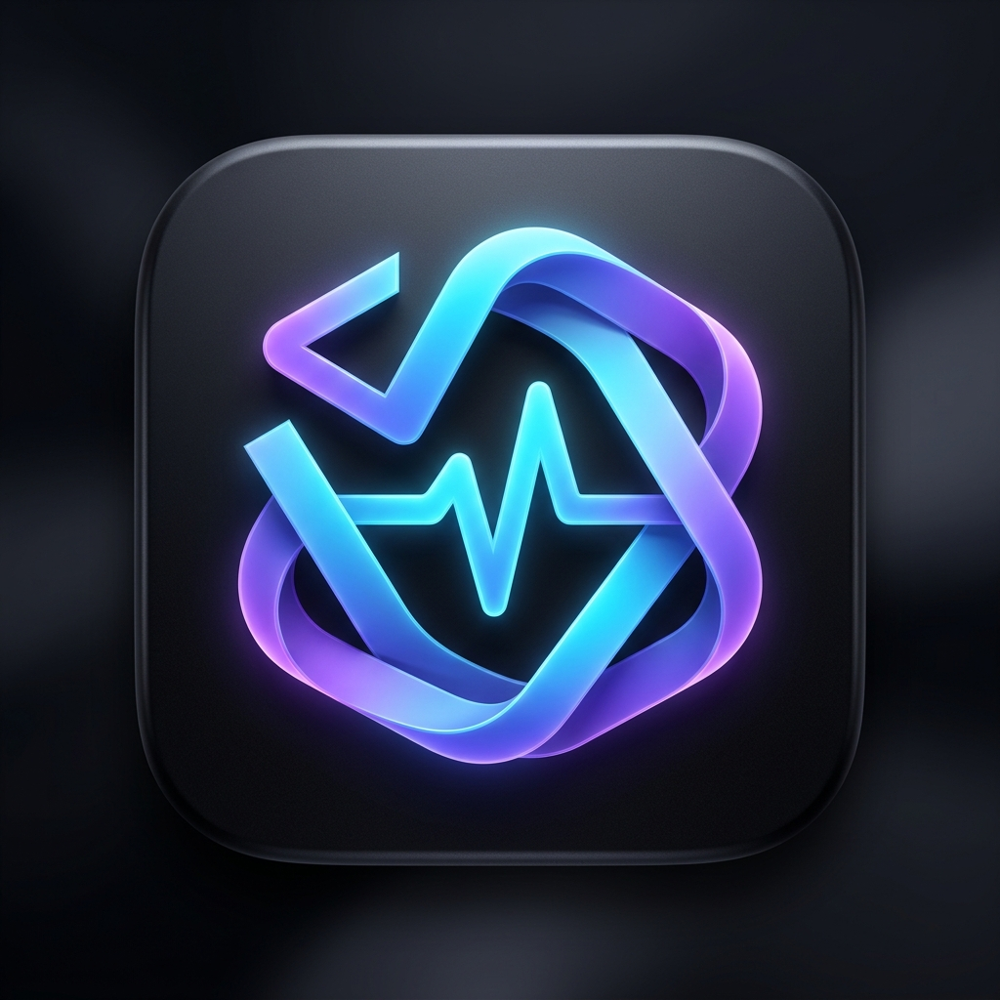
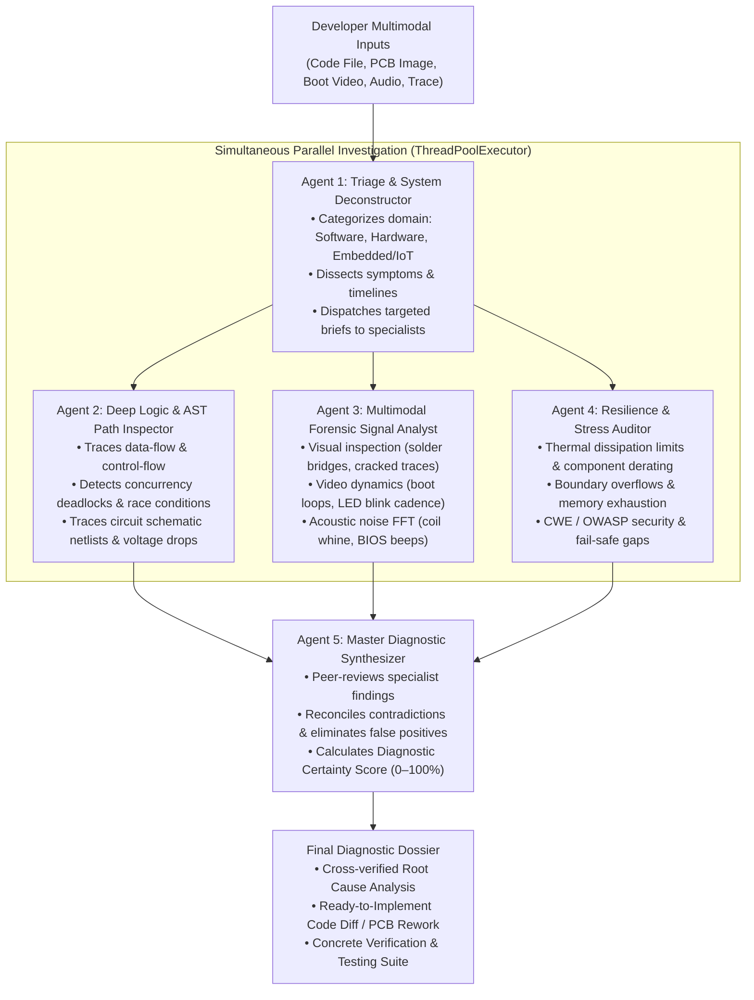

# 🛠️ Dev Diagnosis • AI Multi-Agent Diagnostic Suite

<p align="center">
  
</p>

<p align="center">
  <b>A Concurrent Multi-Agent Forensic Engine for Software & Hardware Debugging</b><br>
  <i>Powered by Google Gemini Multimodal API (gemini-3.8-flash) • Built for Windows (.exe)</i>
</p>

<p align="center">
  
  
  
  
  
</p>

---

## ⚡ What is Dev Diagnosis?

### ❌ What it is NOT:
Dev Diagnosis is **NOT** a shallow "give input, take single-shot answer" chatbot. Traditional AI wrappers send one superficial prompt to an LLM, returning a hasty 2-second guess that frequently misses race conditions, hallucinates fake code, and fails completely when evaluating multimodal hardware signals.

### ✅ What it IS:
Dev Diagnosis is a **forensic-grade, agentic codebase and hardware debugging engine**. When you run an audit, it divides the workload across a **team of 5 specialized autonomous agents** executing simultaneously using the same Gemini API key:



---

## 🔬 Multi-Modal Forensic Inputs Supported

Developers can combine multiple data sources in a single diagnostic session:

| Modality | Examples & Target Scope |
| :--- | :--- |
| **📝 Text & Logs** | Stack traces, GDB/LLDB terminal dumps, crash backtraces, panic outputs, voltage and current readings. |
| **📄 Code & Netlists** | Source code (`.py`, `.ts`, `.cpp`, `.rs`, `.go`, `.java`, `.json`, `.yaml`) as well as circuit netlists and schematics (`.sch`, `.kicad_pcb`, `.net`, `.spice`, `.v`). |
| **🖼️ Visual Images** | High-res PCB board photos, schematic diagrams, oscilloscope waveform captures, component closeups, UI crash dialogs. |
| **🎥 Video Dynamics** | Boot sequences, blinking diagnostic LED rhythms (e.g. ESP32, STM32 status codes), motor/relay flutter, UI bug reproduction walkthroughs. |
| **🔊 Acoustic Signals** | Switching power supply coil whine, ceramic capacitor piezoelectric singing, fan bearing chatter, motherboard/BIOS beep codes. |

---

## 🎨 The Brand Identity: "The Diagnostic Knot"

The logo follows the minimalist, topological design philosophy of **Antigravity**, **Claude (Anthropic)**, and **OpenAI**:

* **Topological Monolithic Silhouette**: Rather than literal illustrations of wires, chips, or text, the logo is an unbroken, continuous geometric ribbon formed into an **isometric hexagonal Möbius loop**.
* **Software + Hardware Fusion**: Seamlessly blends a code bracket angle `>` with a diagnostic pulse wave `^` into an interconnected signature emblem.
* **Palette & Material**: Deep matte obsidian squircle badge with an illuminated two-tone gradient transitioning from **deep electric cyan into radiant violet**.
* **Zero Typography**: Crisp, vector-sharp, and legible down to a 16×16 px Windows taskbar icon.

---

## 🚀 Quick Start Guide

### Option 1: Run the Standalone Windows Executable (.exe)
No Python installation or setup required. Simply run the pre-compiled executable:

```powershell
.\dist\DevDiagnosis.exe
```

### Option 2: Run from Python Source

1. **Clone the Repository**:
   ```bash
   git clone https://github.com/your-username/dev-diagnosis.git
   cd dev-diagnosis
   ```

2. **Create a Virtual Environment & Install Dependencies**:
   ```powershell
   python -m venv venv
   .\venv\Scripts\activate
   pip install -r requirements.txt
   ```

3. **Launch the Application**:
   ```powershell
   python main.py
   ```

4. **Run the Test Suite**:
   ```powershell
   python -m pytest tests/test_units.py -v
   ```

---

## 🔑 Gemini API Key Configuration

1. Get a Gemini API key from [Google AI Studio](https://aistudio.google.com/).
   > [!NOTE]
   > Dev Diagnosis supports both traditional `AIza...` keys and the newest Google Cloud Authorization **`AQ.`** keys.
2. In the app's top header bar, enter your key.
3. Click **Test Key** to verify connectivity with Google’s API model gateway.
4. The key is securely saved locally in `%APPDATA%\DevDiagnosis\settings.json`.

---

## 🖥️ UI Tour & Workspace Features

* **📥 Input Station**: Paste error logs, attach code/netlist files, upload PCB images, video recordings, or audio files. Includes instant presets (*Python Race Condition*, *PCB Power Short*, *ESP32 Boot Loop*, *PSU Coil Whine*).
* **⚡ Agent Telemetry & Live Console**: Watch the 5 autonomous agents transition states in real-time (`IDLE` ➔ `ACTIVE` ➔ `CONCLUDED`) with a live streaming terminal, progress bar, and elapsed stopwatch timer.
* **📋 Diagnostic Dossier**: View the authoritative Root Cause Analysis, ready-to-copy code patches / PCB rework steps, and verification procedures. Export reports with one click to **Markdown (`.md`)** or standalone **HTML (`.html`)**.
* **📚 Audit History**: Automatically persists past diagnostic audits for review and comparison.
* **🌗 Theme Switcher**: Toggle seamlessly between high-contrast **Dark Mode** and clean **Light Mode**.

---

## 📦 Building from Source (PyInstaller)

To compile your own standalone Windows `.exe`:
```powershell
pyinstaller --noconfirm DevDiagnosis.spec
```
The resulting executable will be available at `dist/DevDiagnosis.exe`.

---

## 📄 License
This project is open-source under the [MIT License](LICENSE).
